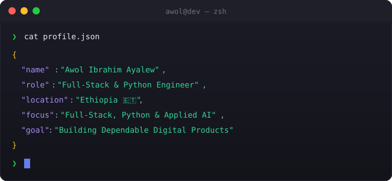

<!-- 
╔══════════════════════════════════════════════════════════════════════════════╗
║                                                                              ║
║             █████╗ ██╗    ██╗ ██████╗ ██╗                                    ║
║            ██╔══██╗██║    ██║██╔═══██╗██║                                    ║
║            ███████║██║ █╗ ██║██║   ██║██║                                    ║
║            ██╔══██║██║███╗██║██║   ██║██║                                    ║
║            ██║  ██║╚███╔███╔╝╚██████╔╝███████╗                               ║
║            ╚═╝  ╚═╝ ╚══╝╚══╝  ╚═════╝ ╚══════╝                               ║
║                                                                              ║
║       🚀 FULL-STACK DEVELOPER • PYTHON ENGINEER • APPLIED AI BUILDER 🚀      ║
║                                                                              ║
╚══════════════════════════════════════════════════════════════════════════════╝
-->

<div align="center">
  
  <!-- ═══════════════════════════════════════════════════════════════════════════ -->
  <!-- 🎯 ANIMATED HEADER                                                          -->
  <!-- ═══════════════════════════════════════════════════════════════════════════ -->
  
  
  
  <br/>
  
  <!-- ═══════════════════════════════════════════════════════════════════════════ -->
  <!-- 📊 PROFILE BADGES                                                           -->
  <!-- ═══════════════════════════════════════════════════════════════════════════ -->
  
  <a href="https://github.com/metiinie">
    
  </a>
  &nbsp;
  <a href="https://github.com/metiinie?tab=repositories">
    
  </a>
  &nbsp;
  <a href="https://github.com/metiinie?tab=followers">
    
  </a>
  &nbsp;
  <a href="https://github.com/metiinie">
    
  </a>
  
</div>

<br/>

<!-- ═══════════════════════════════════════════════════════════════════════════ -->
<!-- 🖥️ TERMINAL INTRO SECTION                                                   -->
<!-- ═══════════════════════════════════════════════════════════════════════════ -->

<div align="center">
  
</div>

<br/>


<br/>

<!-- ═══════════════════════════════════════════════════════════════════════════ -->
<!-- 👤 ABOUT ME SECTION                                                          -->
<!-- ═══════════════════════════════════════════════════════════════════════════ -->


<br/><br/>

<table>
<tr>
<td width="55%" valign="top">

### 🎯 What I Do

```yaml
name: Awol Ibrahim Ayalew
located_in: Ethiopia 🇪🇹
current_status: Full-Stack & Python Software Engineer

areas_of_expertise:
  - 🌐 Full-Stack Web & Backend (Next.js, Vue, Laravel, NestJS)
  - 📱 Mobile Development (React Native & Expo)
  - 🐍 Python & Django Architecture
  - 🗄️ Relational Databases & System Design (PostgreSQL)
  - 🤖 Applied AI & Workflow Automation

currently_building:
  - 🔄 SyncTracker — Workflow & Task Management
  - 🍽️ ArifSmart Menu & Safeland Cafe — Business Apps
  - 🛡️ Civic Eye — Structured Reporting & Accountability
  - 🛋️ Wood-Carvo — Python/Django E-Commerce System
  - 💳 DU Verifay — AI & Automated Payment Verification

life_philosophy: "Turning real problems into dependable software."
```

</td>
<td width="45%" valign="top">

### 🚀 Current Focus

- 🏗️ **Architecting** full-stack web, mobile & backend systems
- 🐍 **Deepening** Python & Django engineering fluency
- 🤖 **Building** reliable Applied AI & intelligent workflows
- 💼 **Solving** practical operational & business challenges
- 🔒 **Enhancing** data security, testing & system reliability
- 🚀 **Shipping** dependable end-to-end digital products

<br/>

### 💡 Quick Facts

- 🇪🇹 Based in Ethiopia
- 💡 Product-minded & end-to-end builder
- ⚡ Focus on real operational workflows
- 🛠️ Curious, pragmatic problem solver

</td>
</tr>
</table>

<br/>


<br/>

<!-- ═══════════════════════════════════════════════════════════════════════════ -->
<!-- 🏆 ACHIEVEMENTS SECTION                                                     -->
<!-- ═══════════════════════════════════════════════════════════════════════════ -->


<br/><br/>

<div align="center">
  
  <!-- GitHub Trophies -->
  <a href="https://github.com/ryo-ma/github-profile-trophy">
    
  </a>
  
</div>

<br/>


<br/>

<!-- ═══════════════════════════════════════════════════════════════════════════ -->
<!-- 📊 GITHUB ANALYTICS                                                         -->
<!-- ═══════════════════════════════════════════════════════════════════════════ -->


<br/><br/>

<div align="center">
  
  <!-- GitHub Stats + Custom Streak in ONE ROW -->
  <a href="https://github.com/metiinie">
    
  </a>
  &nbsp;
  <a href="https://github.com/metiinie">
    
  </a>
  
  <br/><br/>
  
  <!-- 📊 REAL-TIME LANGUAGE USAGE WITH PROGRESS BARS -->
  <a href="https://github.com/metiinie">
    
  </a>
  
  <br/><br/>
  
  <!-- Activity Graph -->
  <a href="https://github.com/metiinie">
    
  </a>
  
  <br/><br/>
  
  <!-- Additional Stats Cards -->
  
  
</div>

<br/>


<br/>

<!-- ═══════════════════════════════════════════════════════════════════════════ -->
<!-- 🎮 CONTRIBUTION SHOWCASE                                                    -->
<!-- ═══════════════════════════════════════════════════════════════════════════ -->


<br/><br/>

<div align="center">
  
  <!-- Pac-Man Contribution Graph -->
  <picture>
    <source media="(prefers-color-scheme: dark)" srcset="./assets/pacman-contribution-graph-dark.svg"/>
    <source media="(prefers-color-scheme: light)" srcset="./assets/pacman-contribution-graph.svg"/>
    
  </picture>
  
  <br/>
  
  <sub>👾 Watch Pac-Man devour my contributions!</sub>
  
</div>

<br/>


<br/>

<!-- ═══════════════════════════════════════════════════════════════════════════ -->
<!-- ⚡ TECH STACK                                                               -->
<!-- ═══════════════════════════════════════════════════════════════════════════ -->


<br/><br/>

<div align="center">

<!-- 💻 LANGUAGES -->
<h4>💻 Languages</h4>
<p>
  <a href="https://www.python.org/" target="_blank"></a>
  <a href="https://developer.mozilla.org/en-US/docs/Web/JavaScript" target="_blank"></a>
  <a href="https://www.typescriptlang.org/" target="_blank"></a>
  <a href="https://developer.mozilla.org/en-US/docs/Web/HTML" target="_blank"></a>
  <a href="https://developer.mozilla.org/en-US/docs/Web/CSS" target="_blank"></a>
  <a href="https://www.gnu.org/software/bash/" target="_blank"></a>
</p>

<!-- 🌐 WEB & MOBILE FRAMEWORKS -->
<h4>🌐 Web &amp; Mobile Development</h4>
<p>
  <a href="https://laravel.com/" target="_blank"></a>
  <a href="https://vuejs.org/" target="_blank"></a>
  <a href="https://nextjs.org/" target="_blank"></a>
  <a href="https://reactjs.org/" target="_blank"></a>
  <a href="https://nestjs.com/" target="_blank"></a>
  <a href="https://nodejs.org/" target="_blank"></a>
  <a href="https://www.djangoproject.com/" target="_blank"></a>
  <a href="https://tailwindcss.com/" target="_blank"></a>
</p>

<!-- 🗄️ DATABASES -->
<h4>🗄️ Databases</h4>
<p>
  <a href="https://www.postgresql.org/" target="_blank"></a>
  <a href="https://www.mysql.com/" target="_blank"></a>
  <a href="https://redis.io/" target="_blank"></a>
  <a href="https://www.sqlite.org/" target="_blank"></a>
  <a href="https://www.mongodb.com/" target="_blank"></a>
</p>

<!-- 🤖 AI & APPLIED INTELLIGENCE -->
<h4>🤖 Applied AI &amp; Machine Learning</h4>
<p>
  <a href="https://www.python.org/" target="_blank"></a>
  <a href="https://scikit-learn.org/" target="_blank"></a>
  <a href="https://pytorch.org/" target="_blank"></a>
</p>

<!-- 🔧 TOOLS & PLATFORMS -->
<h4>🔧 Tools &amp; Platforms</h4>
<p>
  <a href="https://git-scm.com/" target="_blank"></a>
  <a href="https://github.com/" target="_blank"></a>
  <a href="https://www.docker.com/" target="_blank"></a>
  <a href="https://linux.org/" target="_blank"></a>
  <a href="https://code.visualstudio.com/" target="_blank"></a>
  <a href="https://vercel.com/" target="_blank"></a>
  <a href="https://www.figma.com/" target="_blank"></a>
  <a href="https://www.postman.com/" target="_blank"></a>
</p>

</div>

<br/>


<br/>

<!-- ═══════════════════════════════════════════════════════════════════════════ -->
<!-- 🔥 CURRENTLY WORKING ON                                                     -->
<!-- ═══════════════════════════════════════════════════════════════════════════ -->

<div align="center">
  
### ⚡ Currently Building & Learning

<br/>

<a href="https://github.com/metiinie">
  
</a>
&nbsp;
<a href="https://github.com/metiinie">
  
</a>
&nbsp;
<a href="https://github.com/metiinie">
  
</a>

</div>

<br/>


<br/>

<!-- ═══════════════════════════════════════════════════════════════════════════ -->
<!-- 🌐 CONNECT WITH ME                                                          -->
<!-- ═══════════════════════════════════════════════════════════════════════════ -->


<br/><br/>

<div align="center">
  
<a href="https://github.com/metiinie" target="_blank">
  
</a>
&nbsp;
<a href="https://linkedin.com/in/metiinie" target="_blank">
  
</a>
&nbsp;
<a href="mailto:abumahilkerim@gmail.com">
  
</a>

</div>

<br/>


<br/>

<!-- ═══════════════════════════════════════════════════════════════════════════ -->
<!-- 💡 RANDOM DEV QUOTE                                                         -->
<!-- ═══════════════════════════════════════════════════════════════════════════ -->

<div align="center">
  
### 💭 Random Dev Quote

<br/>

<a href="https://github.com/metiinie">
  
</a>

</div>

<br/>

<!-- ═══════════════════════════════════════════════════════════════════════════ -->
<!-- 🌟 FOOTER                                                                   -->
<!-- ═══════════════════════════════════════════════════════════════════════════ -->

<div align="center">
  
  
  
  <br/>
  
  <!-- ☕ BUY ME A COFFEE -->
  <a href="https://buymeacoffee.com/metiinie" target="_blank">
    
  </a>
  
  <br/><br/>
  
  
  
</div>

<!-- ═══════════════════════════════════════════════════════════════════════════ -->
<!-- 📝 END OF README                                                            -->
<!-- ═══════════════════════════════════════════════════════════════════════════ -->
